<p align="center">
  
</p>

<h1 align="center">Mentalys</h1>

<p align="center">
  Multimodal depression-risk screening for Android, combining the PHQ-9 questionnaire,<br/>
  on-device facial emotion recognition and on-device speech emotion recognition.
</p>

<p align="center">
  <a href="https://github.com/mdprana/mentalys/releases/latest"></a>
  
  
  
</p>

---

Mentalys was built as my undergraduate thesis at Universitas Udayana:
*"Implementasi Pendekatan Multimodal Deep Learning dalam Rancang Bangun Sistem Skrining Awal Kesehatan Mental (Risiko Depresi) Berbasis Android"*.

The app estimates an early depression-risk level from up to three signals. Face and voice are analysed entirely on the device with TensorFlow Lite, so raw images and recordings never leave the phone. Only the resulting screening metadata is synced for signed-in users.

> **Disclaimer.** Mentalys is a screening aid, not a diagnostic tool. Results are indicative only. If you are struggling or in crisis, please contact a mental-health professional or someone you trust.

## Download

Get the latest signed APK from the [Releases page](https://github.com/mdprana/mentalys/releases/latest), copy it to an Android 7.0+ device, allow installs from unknown sources, and install. Grant camera and microphone access when the screening asks for it.

## Screenshots

| Login | Home | Screening | PHQ-9 |
|:---:|:---:|:---:|:---:|
| 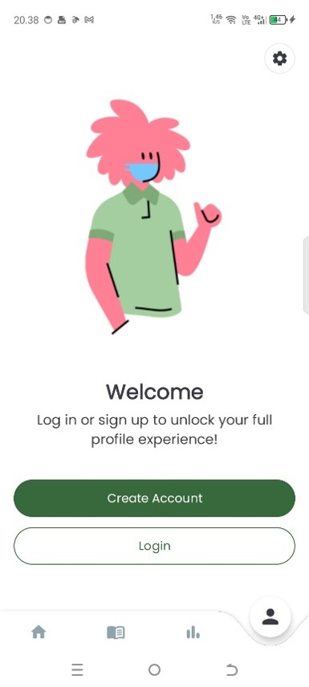 | 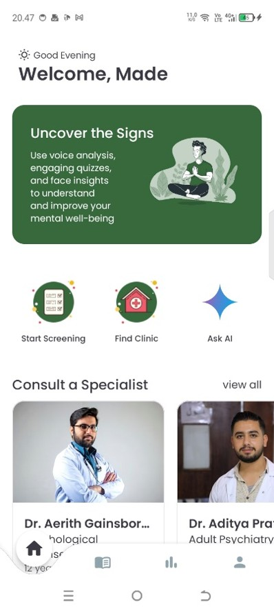 | 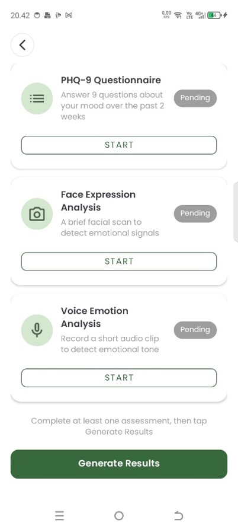 | 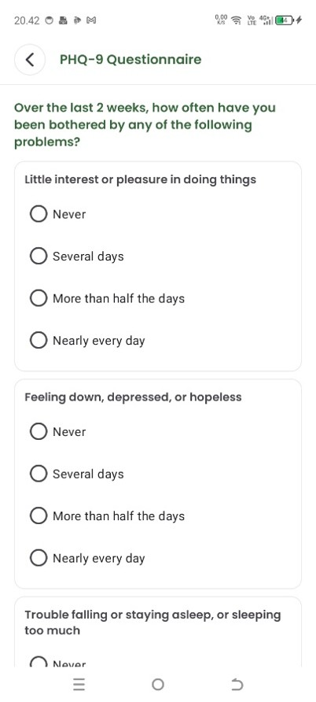 |

| Voice analysis | Face analysis | Result | AI interpretation |
|:---:|:---:|:---:|:---:|
| 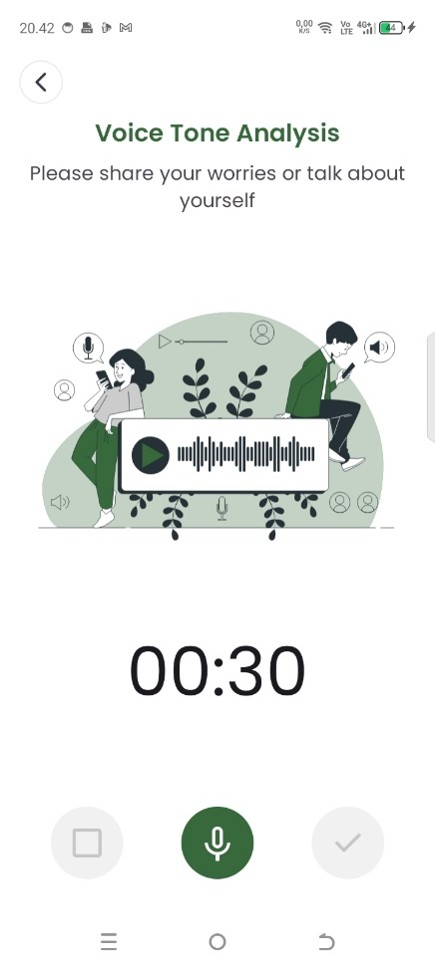 | 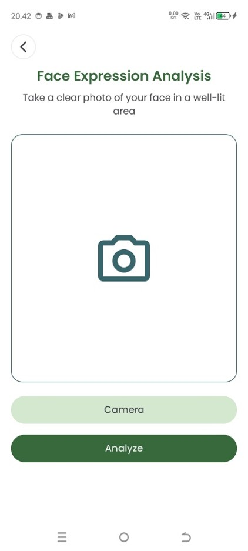 | 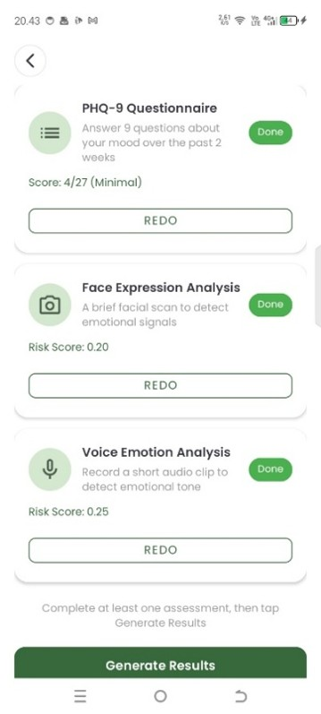 | 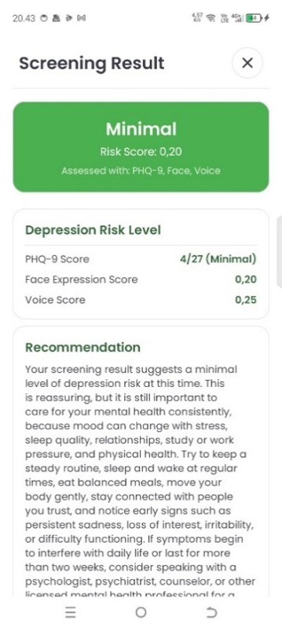 |

| Ask AI | History | Specialists | Payment |
|:---:|:---:|:---:|:---:|
| 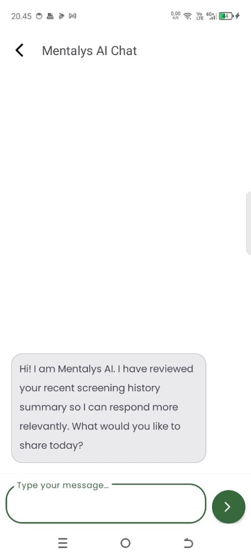 | 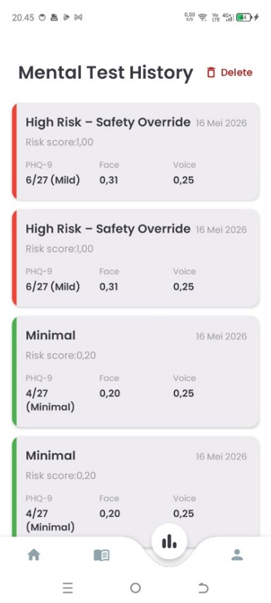 |  | 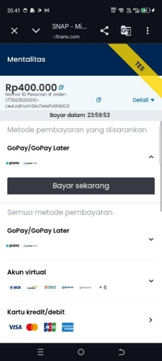 |

| Nearby clinics | Mentalys Pedia | Settings |
|:---:|:---:|:---:|
| 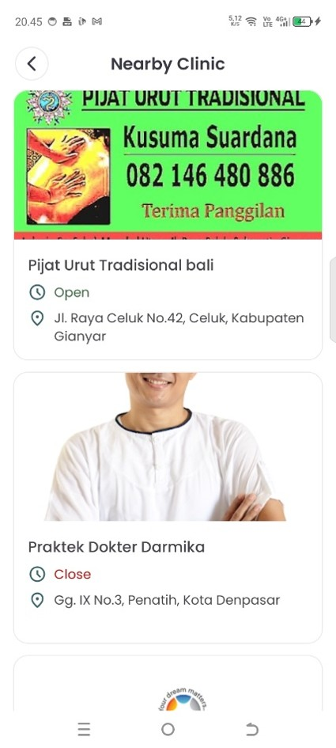 | 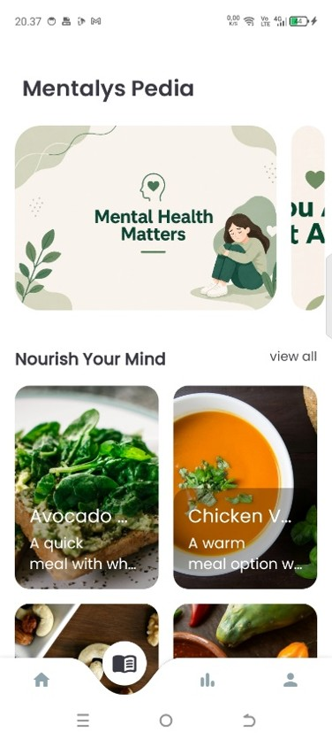 | 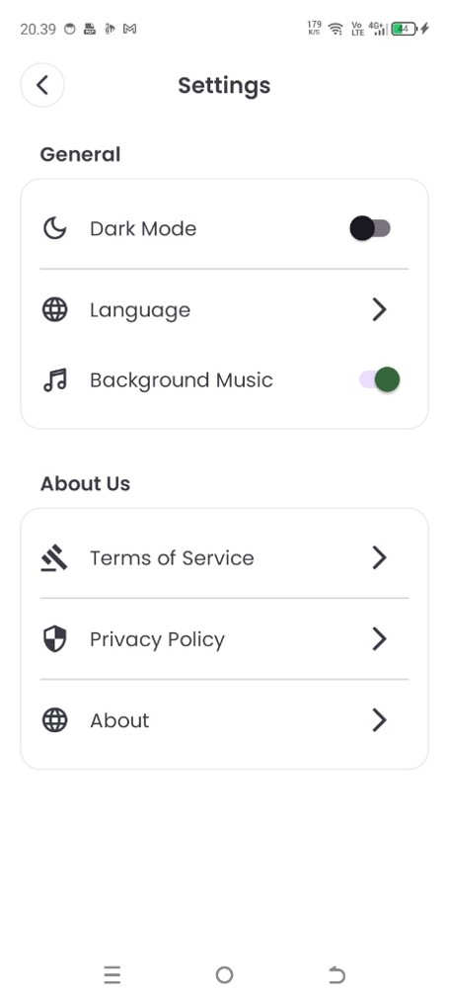 |

## Features

- **Multimodal screening.** PHQ-9 questionnaire, facial expression analysis from the front camera and speech emotion analysis from a short recording. Any subset of the three can be completed and the score adapts.
- **On-device inference.** Both deep learning models run locally with TensorFlow Lite; ML Kit handles face detection and cropping.
- **Explainable scoring.** A deterministic formula produces the risk score first. Gemini then explains the result in plain English or Bahasa Indonesia, and never decides the score itself.
- **Safety override.** A PHQ-9 total of 20 or more, or any non-zero answer on item 9 (self-harm), escalates the result regardless of the other signals.
- **Ask AI.** A multi-turn Gemini chat for mental-health questions.
- **Screening history.** Stored locally with Room for guests and synced to Firestore through the backend for signed-in users.
- **Care network.** Specialist directory with Static Maps preview and WhatsApp contact, consultation booking through Midtrans (sandbox), and a nearby clinic finder backed by Google Places.
- **Mentalys Pedia.** Articles and mood-food recommendations served from Firestore.
- **Relaxation music** from Freesound with an in-app toggle.
- Email/password and Google Sign-In through Firebase Auth, dark mode, and full English/Indonesian localisation.

## How the risk score works

Each model outputs class probabilities, which are first softened with temperature scaling (T = 1.5 for face, T = 2.5 for voice) so an over-confident softmax does not collapse the score to 0 or 1. They are then mapped to a risk proxy in the range 0 to 1:

```text
FaceRisk  = clamp( P(sad) + 0.5·P(neutral) - P(happy) )
AudioRisk = clamp( P(sad) + 0.5·P(neutral) + 0.25·P(calm) - P(happy) )
PHQnorm   = PHQ-9 total / 27
```

Fusion:

```text
All three        FinalRisk = 0.45·PHQnorm + 0.35·AudioRisk + 0.20·FaceRisk
Face + voice     FinalRisk = 0.55·FaceRisk + 0.45·AudioRisk
Other subsets    the available weights from the first formula, renormalised
```

| Final score | Level |
|---|---|
| 0.00 to 0.20 | Minimal |
| 0.21 to 0.40 | Mild |
| 0.41 to 0.60 | Moderate |
| 0.61 to 0.80 | High |
| 0.81 to 1.00 | Severe |

Implementation: [`RiskMapper.kt`](app/src/main/java/com/mentalys/app/ml/fusion/RiskMapper.kt) and [`RiskFusionEngine.kt`](app/src/main/java/com/mentalys/app/ml/fusion/RiskFusionEngine.kt), covered by unit tests in `app/src/test`.

## Models

| Modality | Architecture | Dataset | Test accuracy | Size | On-device inference* |
|---|---|---|---|---|---|
| Face | VGG-16 + SE + attention, 224×224 RGB, 7 classes | FER-2013 | 68.3% | 15.2 MB | ~0.33 s (≈1.0 s incl. detection and preprocessing) |
| Voice | CNN-BiLSTM on MFCC features (130×120), 8 classes | RAVDESS | 97.2% | 7.3 MB | ~0.02 s (≈0.64 s incl. MFCC extraction) |

\*Measured on a Xiaomi 2405CPCFBG running Android 15. The voice model uses TensorFlow Select ops, loaded through the Flex delegate. MFCC extraction uses JLibrosa to match the librosa pipeline used in training.

## Tech stack

| Layer | Technology |
|---|---|
| Language and UI | Kotlin, XML Views, ViewBinding, Material Components |
| Architecture | MVVM, Repository pattern, manual dependency injection |
| On-device ML | TensorFlow Lite + Select TF Ops, ML Kit Face Detection, CameraX, JLibrosa |
| Generative AI | Gemini 2.5 Flash / Flash-Lite (Google AI client SDK) |
| Data | Room, DataStore Preferences, Retrofit, OkHttp |
| Auth | Firebase Auth, Google Sign-In, backend token verification |
| Media and payments | AndroidX Media3 (ExoPlayer), Midtrans UIKit (sandbox) |
| Backend | TypeScript, Express, Firebase Admin SDK, Firestore, Google Cloud Run |

## Architecture

```text
app/src/main/java/com/mentalys/app
├── data
│   ├── local         Room database, DAOs, entities
│   ├── remote        Retrofit services, requests, responses
│   └── repository    Data access and sync logic
├── di                Manual dependency injection
├── ml
│   ├── face          Face preprocessing and TFLite inference
│   ├── voice         Audio preprocessing, MFCC, TFLite inference
│   └── fusion        Risk mapping, fusion and categorisation
├── ui                Activities, fragments, adapters, view models
└── utils             Preferences, auth token handling, localisation helpers
```

The app talks to four backend services on Google Cloud Run:

| Service | Responsibility |
|---|---|
| Main API | Auth, profile, screening history, specialist data, Midtrans charge |
| Article & Food API | Firestore-backed Mentalys Pedia content |
| Clinic API | Nearby clinic search via Google Places |
| Psychiatrist Contact API | Specialist contact and place lookups |

## Building from source

Requirements: Android Studio (recent stable), JDK 17+, Android SDK 35. The app targets API 35 with a minimum of API 24.

1. Clone the repository.
2. Add your own Firebase config as `app/google-services.json` (it is not committed).
3. Create `local.properties` in the project root:

   ```properties
   sdk.dir=/path/to/Android/Sdk

   # GitHub Packages token with read:packages (Liquid Swipe, TarsosDSP)
   gpr.user=your_github_username
   gpr.key=your_github_token

   GEMINI_API_KEY=...
   STATIC_GOOGLE_MAPS_API_KEY=...
   ROUTES_GOOGLE_MAP_API_KEY=...
   FREE_SOUND_API_KEY=...
   MIDTRANS_CLIENT_KEY=...

   BASE_URL_MAIN=https://<main-api>/api/
   BASE_URL_ARTICLES=https://<article-food-api>/api/v1/
   BASE_URL_CLINIC=https://<clinic-api>/
   BASE_URL_PSYCHIATRIST=https://<psychiatrist-api>/api/
   BASE_URL_FREE_SOUND=https://freesound.org/apiv2/
   ```

4. Build and test:

   ```bash
   ./gradlew :app:assembleDebug        # debug APK
   ./gradlew :app:testDebugUnitTest    # risk scoring unit tests
   ./gradlew :app:connectedAndroidTest # TFLite runtime, Room and inference benchmarks (device required)
   ```

`local.properties`, `google-services.json`, keystores and APKs are git-ignored. Never commit API keys.

## Author

**Made Pranajaya Dibyacita**, Informatics, Universitas Udayana.
Supervisor: Dr. Dra. Luh Gede Astuti, M.Kom.
